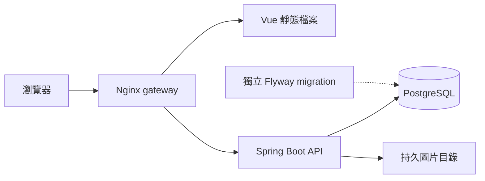

# Developer Portfolio

*A full-stack engineering portfolio with a PostgreSQL-backed catalog and a role-based content management system.*

這是供工程主管與招募人員審閱的求職作品集平台，集中呈現作品功能、技術架構、工程案例與驗證依據。訪客可瀏覽與搜尋作品；擁有者透過管理後台維護內容、圖片與發布狀態，減少展示資料散落於不同倉庫或必須重新建置前端才能更新的問題。

## 展示

- [公開唯讀展示](https://swaggyserver.tail5b604b.ts.net:8443/)：提供作品瀏覽，不開放訪客操作管理功能。
- 收錄的作品（首頁精選前四項）：
  - [發呆亭](https://github.com/jackteng-dev/fadaiting-camp)：露營訂位與現場營運
  - Figura（畫面仍顯示舊名 ELPSY Shop）：公仔電商，[API](https://github.com/jackteng-dev/figura-api)／[網站](https://github.com/jackteng-dev/figura-web)／[App](https://github.com/jackteng-dev/figura-app)
  - [Encore](https://github.com/jackteng-dev/encore-ticketing)：排隊與非同步售票
  - [Atlas](https://github.com/jackteng-dev/atlas-rag)：本地 RAG 知識助理（應用本身未公開）
- 作品案例與來源依據見[作品目錄](docs/PROJECT_CATALOG.md)；架構圖為說明圖，平台截圖不代表來源應用的操作截圖。

## 主要功能

- 響應式首頁、作品列表、作品詳情與關於頁；支援搜尋、分類／技術篩選與分頁。
- 公開唯讀 API 從 PostgreSQL 取得作品、技術、媒體與證據，資料庫不可用時回報錯誤，無靜態資料備援。
- 管理後台支援作品新增、編輯、刪除、發布、排序，以及分類／技術字典維護。
- ADMIN／VIEWER 角色、帳號啟用與停用、本人密碼更改、Session 撤銷及最後管理員保護。
- 作品版本衝突檢查、內容變更稽核、PNG／JPEG 上傳、草稿圖片權限與退役圖片回收。

## 技術架構

| 層 | 技術 |
| --- | --- |
| 前端 | Vue 3、TypeScript、Vue Router、Vite、Tailwind CSS |
| API 與驗證 | Java 21、Spring Boot 3.5.16、Spring Security、Spring Session JDBC |
| 資料 | PostgreSQL 17、Spring JDBC、Flyway；獨立本機圖片儲存 |
| 容器交付 | Docker Compose、Nginx 同源入口、獨立 migration 程序 |
| 驗證與發布 | Maven、Playwright、Python 防護測試、GitHub Actions、私人 GHCR |

以下為本倉庫容器部署的元件；migration 是更新資料庫時執行的一次性程序。



## 工程重點

- **並行修改與稽核一致性**：寫入時重新核對管理者權限，搭配交易鎖與預期版本檢查，將作品、關聯與稽核放在同一交易；衝突回傳 409，避免覆蓋他人修改。見[作品管理](docs/ADMIN_PROJECTS.md)。
- **權限與流量邊界**：分離唯讀查詢、管理寫入與 migration 資料庫角色；Session／CSRF、持久登入限流與匿名 Session 配額共同保護後台，gateway 來源宣告須通過私有網路與密鑰核對。見[登入安全](docs/LOGIN_SAFETY.md)與[HTTPS](docs/HTTPS.md)。
- **圖片與資料庫的生命週期**：實際解碼並重新編碼圖片，以引用與發布狀態控制存取；檔案先落盤，再提交版本與稽核，失敗殘留由具寬限期、可重試的回收程序處理。見[圖片管理](docs/MEDIA_MANAGEMENT.md)。
- **可核對的內容更新**：展示匯入先產生包含版本與雜湊的審閱計畫，套用前重查目標，透過管理 API 與版本檢查寫入；不自動覆寫既有 seed 或重試未知結果。見[展示內容流程](docs/SHOWCASE_CONTENT.md)。
- **協調備份與隔離還原**：停止寫入後共同備份 PostgreSQL 與圖片，驗證資料、權限及檔案雜湊，只還原至全新環境；排除 Session 資料，還原後需重新登入。見[備份與還原](docs/BACKUP_RESTORE.md)。

## 品質與交付

[GitHub Actions `verify`](.github/workflows/ci.yml) 在 PR 與 main 更新時執行：隔離 PostgreSQL 的完整 Maven package、前端型別檢查與 production build、Python 防護測試、真 Nginx／容器 API 與 Playwright 回歸，以及使用專用測試 CA、啟用憑證與主機名稱驗證的 HTTPS 驗收。

驗證涵蓋角色／CSRF、版本衝突、圖片存取、服務重啟、資料庫故障與相容版本回退。CI 僅上傳數值與雜湊摘要；歷史結果與測試替身的範圍見[驗證紀錄](docs/VERIFICATION.md)，不視為本次文件修改的測試結果。

交付流程為 PR → `verify` 通過 → 合併 main → main CI 通過 → [發布私人 GHCR 映像](.github/workflows/homelab-release.yml) → 擁有者自架主機定期拉取並部署（pull-based CD）。發布核對來源版本與映像 digest；部署狀態與最近一次實測範圍見[交接紀錄](docs/HANDOFF.md)。

## 本機啟動

需 JDK 21、Maven 3.9、Node.js ≥ 22.12、npm、Python 3 與 Docker Compose v2。從倉庫根目錄執行；測試與展示使用不同的專屬資料庫。

```bash
npm ci
python scripts/portfolio_db.py init --directory work/pg-test --port 25486 --database portfolio_test
python scripts/portfolio_db.py up --directory work/pg-test
python scripts/portfolio_db.py exec --directory work/pg-test -- mvn -f backend/pom.xml clean package
python scripts/portfolio_db.py down --directory work/pg-test --purge
python scripts/portfolio_db.py init --directory work/pg-demo --port 25487 --database portfolio_demo
python scripts/portfolio_db.py up --directory work/pg-demo
PORTFOLIO_COOKIE_SECURE=false python scripts/portfolio_db.py exec --directory work/pg-demo -- npm run backend:start
```

另一個終端啟動前端：

```bash
npm run dev
```

`PORTFOLIO_COOKIE_SECURE=false` 僅供本機 loopback HTTP；HTTPS 部署須保留 Secure Cookie。前端 production build 使用 `npm run build`，包含型別檢查。完整環境、停止／重啟與保留資料方式見[資料庫與本機設定](docs/PERSISTENCE.md)；建立本機管理帳號見[管理登入](docs/ADMIN_AUTH.md)。

## 已知限制

- 定位為持續開發的求職展示平台；單機容器與本機圖片儲存，不宣稱高可用或正式營運規模。
- 尚無忘記密碼重設、外部身分提供者及外部物件儲存整合。
- 備份為需停止寫入的手動離線快照；尚無加密異地副本、PITR 與量化 RPO／RTO。
- 倉庫 HTTPS 工具尚未提供 ACME 自動簽發／續期；私有測試 CA 驗收不能替代公開入口的憑證與長期運行驗證。
- 部分作品仍缺來源應用的實際操作截圖；裝飾封面與架構說明圖不作為功能驗收證據。

## 文件

- [公開 API 契約](docs/PUBLIC_API.md)
- [作品管理、版本與稽核](docs/ADMIN_PROJECTS.md)
- [帳號與角色治理](docs/ADMIN_ACCOUNTS.md)
- [容器部署與相容回退](docs/DEPLOYMENT.md)
- [CI 驗證流程](docs/CI.md)
- [平台頁面截圖與使用限制](docs/screenshots/showcase-2026-10-13/README.md)
- [完整開發紀錄（原 README）](docs/DEV_LOG.md)
